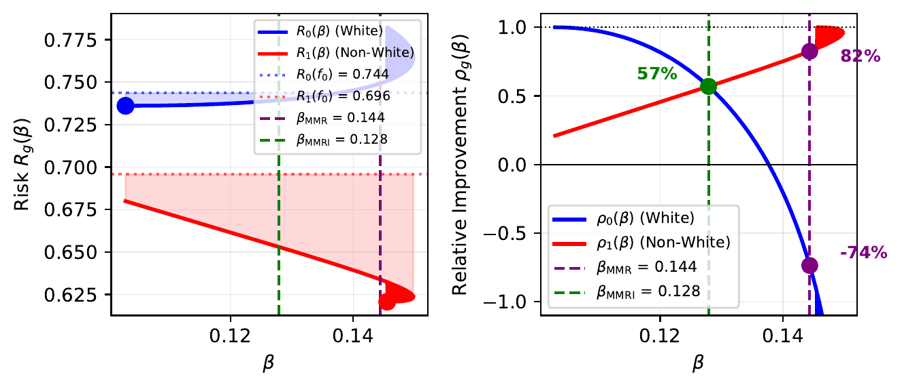
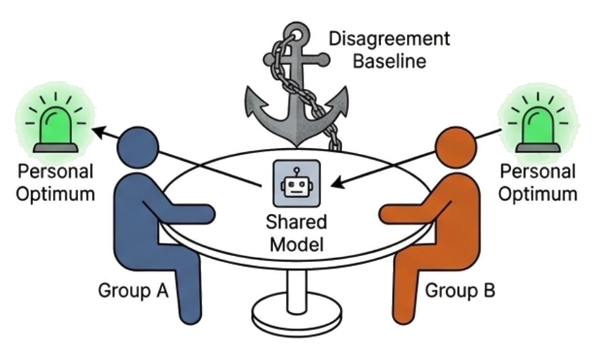

# 🤝 Maximin Relative Improvement: Fair Learning as a Bargaining Problem

**Jiwoo Han, Moulinath Banerjee, Yuekai Sun**
*International Conference on Machine Learning (ICML), 2026*

📄 [Paper (PMLR)](https://proceedings.mlr.press/v306/han26a.html) · 📝 [arXiv](https://arxiv.org/abs/2602.04155) · 💬 [OpenReview](https://openreview.net/forum?id=9KOJdlFH82) · 🪧 [ICML poster](https://icml.cc/virtual/2026/poster/65865) · 📥 [PDF](paper/maximin_relative_improvement_icml2026.pdf)

This repository contains the code that reproduces the figures and tables of the paper.

## 🔍 Overview

When a single predictor is deployed across several groups, the groups rarely agree on which model is best, so some compromise is unavoidable. Worst-case criteria such as Group DRO and minimax regret (MMR) settle this compromise on an absolute scale, as if one unit of loss reduction meant the same for every group. It does not. When predicting the income of white and non-white workers in North Dakota from age, the non-white group can gain roughly ten times more from its best model than the white group can. MMR ignores this difference, and it leaves white workers worse off than the baseline predictor. We instead measure each group's **relative improvement**, the fraction of its achievable risk reduction that a model actually captures, and maximize the worst one:

$$
\rho_g(f) = \frac{R_g(f_0) - R_g(f)}{R_g(f_0) - R_g(f_g^\ast)},
\qquad
f_{\mathrm{RI}} = \arg\max_{f \in \mathcal{F}} \min_{g} \rho_g(f).
$$

<p align="center">
  
</p>
<p align="center"><em>North Dakota, race partition, age as the only feature (Figure 1 of the paper). MMR gives relative improvements of (−74%, 82%), while maximin relative improvement (MMRI) gives both groups 57%.</em></p>

We view fair learning as a **cooperative bargaining problem**. Each group concedes from its own optimum $f_g^\ast$ to agree on a shared model, and if no agreement is reached, every group falls back to the baseline $f_0$, which plays the role of the disagreement point. Existing criteria then turn out to be classical bargaining solutions: Group DRO is the Rawlsian solution, maximin explained variance (MMV) is the egalitarian solution, and MMR is the equal-loss solution. MMRI is exactly the **Kalai–Smorodinsky solution**, which for two groups is the unique solution satisfying Pareto optimality, symmetry, scale invariance and individual monotonicity. When $f_0 \in \mathcal{F}$, MMRI never leaves a group worse off than the baseline, and its empirical estimator converges at the rate $O(1/\sqrt{n})$.

<p align="center">
  
</p>
<p align="center"><em>Fairness as bargaining: the groups negotiate over one shared model. Each would prefer its own optimum, and if they cannot agree, everyone falls back to the baseline.</em></p>

### ⚖️ Choosing a criterion by its axioms

Because every criterion is a bargaining solution, the criteria can be compared by the axioms they satisfy (Table 1 of the paper).

| Bargaining solution | Fairness criterion | PO | SYM | SI | IIA | IM | TI | SM |
|---|---|:-:|:-:|:-:|:-:|:-:|:-:|:-:|
| Kalai–Smorodinsky, $m=2$ (maximin = equal) | **MMRI** | ✓ | ✓ | ✓ | ✗ | ✓ | ○ | ✗ |
| Kalai–Smorodinsky, $m>2$ (leximin) | **MMRI** | ✓ | ✓ | ✓ | □ | □ | ○ | ✗ |
| Nash, general $m$ | Nash | ✓ | ✓ | ✓ | ✓ | ✗ | ○ | ✗ |
| Egalitarian (equal) | MMV | △ | ✓ | ✗ | ✗ | ○ | ✓ | ✓ |
| Egalitarian, $m=2$ (maximin = equal) | MMV | ✓ | ✓ | ✗ | ✗ | ○ | ✓ | ✓ |
| Equal loss (equal) | MMR | △ | ✓ | ✗ | ✗ | ✗ | ✓ | □ |

PO = Pareto optimality, SYM = symmetry, SI = scale invariance, IIA = independence of irrelevant alternatives, IM = individual monotonicity, TI = translation invariance, SM = strong monotonicity. The definitions are in Section 4 and Appendix E.1 of the paper.

✓ satisfied and used for the characterization · □ satisfied after modification and used for the characterization · ○ satisfied but not used · △ only weak Pareto optimality · ✗ violated.

Group DRO, MMV and MMR share the same axiomatic structure and differ only in their reference points, so MMV and MMR stand in for all three.

Each axiom expresses a different fairness requirement, and no criterion satisfies all of them at once. Since most criteria already select Pareto-optimal models, Pareto dominance alone cannot rank them either. What the table shows instead is that each criterion is uniquely characterized by a distinct set of axioms. We therefore read it as a **decision guide**: first decide which axioms matter in your application, and the criterion is then uniquely determined. For example, when groups differ substantially in how predictable they are, scale invariance is essential, which makes MMRI the natural choice. If strong monotonicity matters more to you than scale invariance, the same reasoning leads to the egalitarian solution instead.

## 🗂️ Repository structure

```
├── paper/                                    # the ICML 2026 paper (PDF)
├── assets/                                   # images used in this README
├── scripts/
│   ├── folktables_utils.py                   # ACS loading and preprocessing
│   ├── train_methods.py                      # closed-form reweighted least squares, group oracles,
│   │                                         # gradient-based Group DRO / MMR / MMRI
│   ├── oracle_gap_scan_employed.ipynb        # oracle gaps for all states, partitions and feature subsets
│   ├── summary.ipynb                         # Table 2 and gap-ratio statistics
│   ├── generate_all_figures_final.ipynb      # experiment figures (Figures 5, 8, 9, 10)
│   └── figure1_nd_race_age.ipynb             # Figure 1 (also panel (f) of Figure 9)
├── oracle_gap_scan_sex_employed.csv          # precomputed output of oracle_gap_scan_employed.ipynb
├── oracle_gap_scan_race_binary_employed.csv
├── figures_final/                            # experiment figures as they appear in the paper
└── concept_figures/                          # illustrative figures (Figures 2, 3, 4, 6, 7)
```

## 🔁 Reproducing the results

The experiments use the 2018 American Community Survey (ACS), accessed through [folktables](https://github.com/socialfoundations/folktables), to predict log personal income of full-time, year-round workers in all 50 U.S. states. We use two binary group partitions (sex; white vs. non-white) and four features (age `AGEP`, education `SCHL`, marital status `MARC`, householder status `RELPC`). For each configuration, group-reweighted least squares is solved in closed form over 10,001 values of $\lambda \in [0, 1]$ to trace the Pareto frontier. ERM, Group DRO, MMR, MMV, MMRI and Nash each select their solution from this frontier.

### ⚙️ Setup

```bash
pip install folktables numpy pandas scikit-learn torch matplotlib scipy jupyter
```

Tested with Python 3.13.5, folktables 0.0.12, numpy 2.3.4, pandas 2.3.3, scikit-learn 1.7.2, torch 2.9.1, matplotlib 3.10.7 and scipy 1.16.3.

On the first run, folktables downloads the 2018 ACS 1-Year person files into `scripts/data/`. The files for all 50 states take about 2 GB.

### 🧪 Experiments

The notebooks use paths relative to `scripts/`, so run them from that directory, in this order:

1. **`oracle_gap_scan_employed.ipynb`** computes the oracle gap of each group for every state, partition and feature subset, and writes `oracle_gap_scan_{sex,race_binary}_employed.csv`. This step loads all 50 states and takes a while. The CSV files are already included, so you can skip it.
2. **`summary.ipynb`** reproduces Table 2 and the gap-ratio statistics reported in Section 6. The gap ratio of each configuration (for example, those in the captions of Figures 8 and 10) is the `gap_ratio_g0_g1` column of the CSV files.
3. **`generate_all_figures_final.ipynb`** regenerates 17 of the 18 experiment figures in `figures_final/` (as PDF and PNG).
4. **`figure1_nd_race_age.ipynb`** draws the remaining one, Figure 1, which is also panel (f) of Figure 9.

### 🎨 Illustrative figures

The notebooks in `concept_figures/` draw the figures built on synthetic examples and save them as PDFs in the same directory. `plot.ipynb` draws Figures 2, 3, 6 and 7, and `plot_linear_regression.ipynb` draws Figure 4 from the linear regression example in Appendix F.3.

## 📊 Figures and tables

| Paper | File | Notebook |
|---|---|---|
| Figure 1 | `figures_final/fig1_analog_ND_race_binary_AGEP_employed.pdf` | 🧪 `scripts/figure1_nd_race_age.ipynb` |
| Figure 2 | `concept_figures/risk_utility_transformation.pdf` | 🎨 `concept_figures/plot.ipynb` |
| Figure 3 | `concept_figures/fairness_methods_comparison.pdf` | 🎨 `concept_figures/plot.ipynb` |
| Figure 4 | `concept_figures/convex_hull_bargaining.pdf` | 🎨 `concept_figures/plot_linear_regression.ipynb` |
| Figure 5 | `figures_final/intro_diff_scale_ND_race_binary_AGEP_employed.pdf` | 🧪 `scripts/generate_all_figures_final.ipynb` |
| Figure 6 | `concept_figures/ellipse_comparison.pdf` | 🎨 `concept_figures/plot.ipynb` |
| Figure 7 | `concept_figures/bargaining_solutions.pdf` | 🎨 `concept_figures/plot.ipynb` |
| Figure 8 | `figures_final/intro_diff_scale_{CA,HI,ND}_*_{AGEP,MARC,SCHL}_employed.pdf` | 🧪 `scripts/generate_all_figures_final.ipynb` |
| Figure 9 | `figures_final/fig1_analog_*.pdf` | 🧪 `scripts/generate_all_figures_final.ipynb` (panels a–e), `scripts/figure1_nd_race_age.ipynb` (panel f) |
| Figure 10 | `figures_final/intro_diff_scale_*_all_features_employed.pdf`, `figures_final/intro_diff_scale_ND_*_employed_all4.pdf` | 🧪 `scripts/generate_all_figures_final.ipynb` |
| Table 2 | — | 📈 `scripts/summary.ipynb` |

## 📚 Citation

```bibtex
@InProceedings{pmlr-v306-han26a,
  title     = {Maximin Relative Improvement: Fair Learning as a Bargaining Problem},
  author    = {Han, Jiwoo and Banerjee, Moulinath and Sun, Yuekai},
  booktitle = {Proceedings of the 43rd International Conference on Machine Learning},
  pages     = {39539--39570},
  year      = {2026},
  volume    = {306},
  series    = {Proceedings of Machine Learning Research},
  publisher = {PMLR},
  url       = {https://proceedings.mlr.press/v306/han26a.html}
}
```

## 📜 License

The code is released under the [MIT License](LICENSE).
